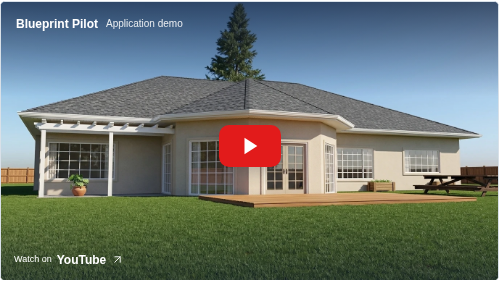
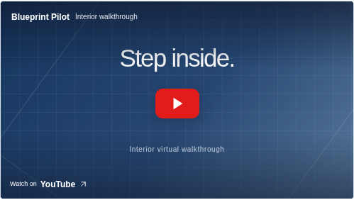
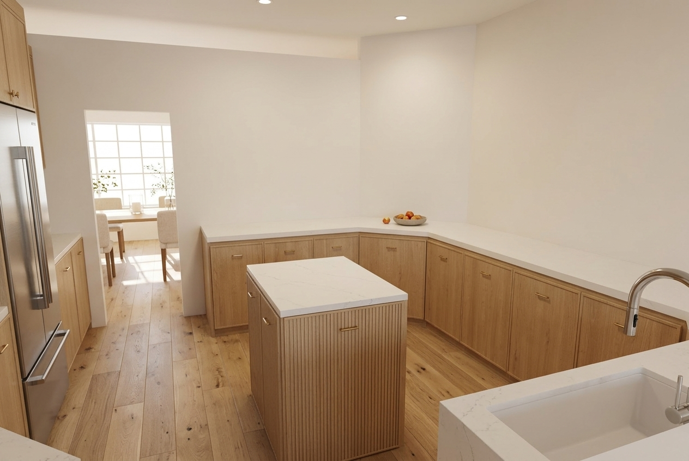
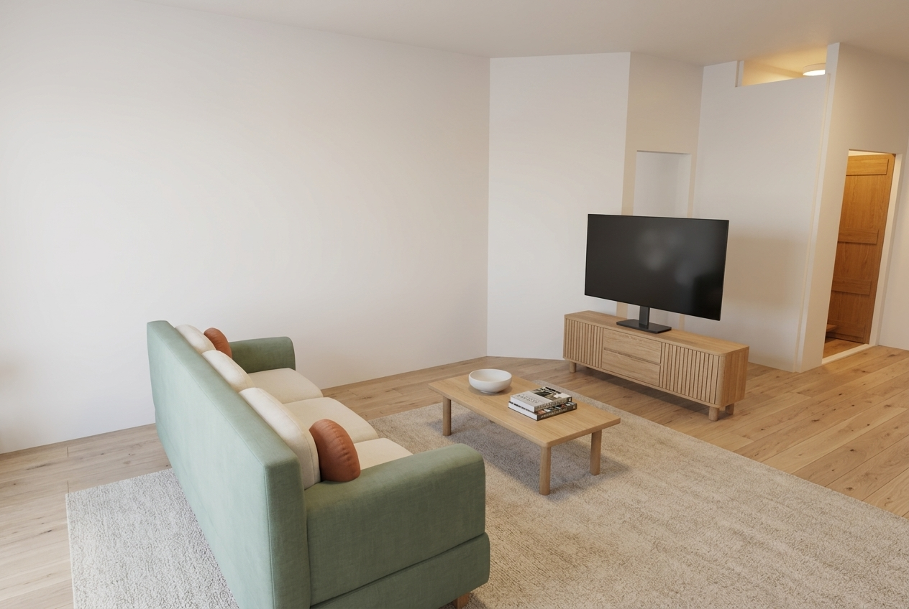
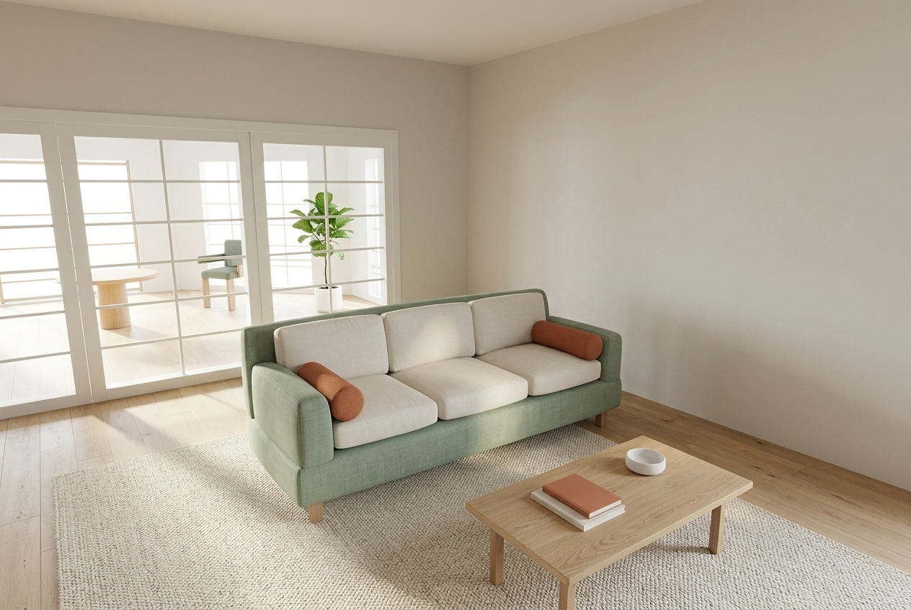
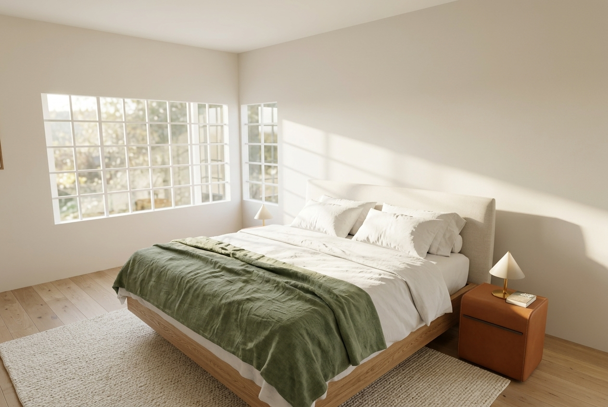
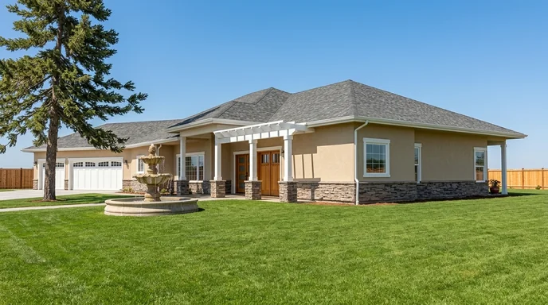
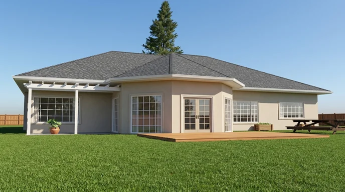
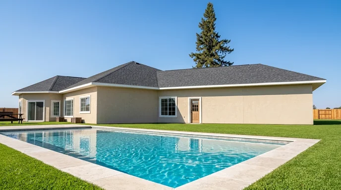
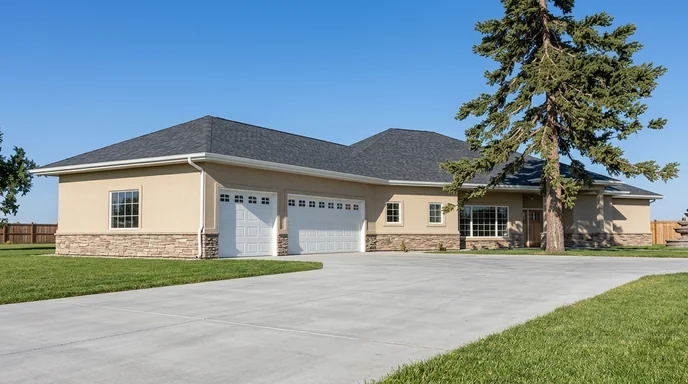

# Blueprint Pilot

**From 2D blueprints to a complete home visualization.**

Blueprint Pilot is a vertical AI application in development, with a three-phase vision: build a 3D house from 2D blueprints, place it within a modeled site and landscape, then create realistic interior walkthroughs and photorealistic interior visuals. The goal is to support the journey from early design to customer presentations and future real-estate listing media, including Zillow postings.

House modeling is working in the Gemini prototype. Current development focuses on phase 2: refining house, site and landscape integration, supported by drawing-linked geometry review.

**Drawing PDF → structured building scene → geometry review → model-view capture**

I'm Harufumi Nomura, founder of Nomura Automation. **I led the design, implementation, debugging and review**, using Codex and Gemini for coding assistance. The work spans two prototypes that implement different parts of this workflow.

[Watch the application demo](https://youtu.be/gYKAEUHcBgE)

## Three-phase roadmap

| Phase | Intended outcome | Status |
| --- | --- | --- |
| **1. House modeling** | Develop a 3D house model from 2D blueprints, with drawing-linked components and geometry review. | Working in the Gemini prototype; geometry review and refinement continue. |
| **2. Site and landscape** | Combine the house with a 3D site and landscape model to support site planning and show the home in its surroundings. | Current development and refinement focus in the Gemini prototype. |
| **3. Interior visualization** | Add realistic interior walkthroughs, culminating in photorealistic interior visuals for customer presentations and future real-estate listing media. | Planned; the interior walkthrough video below illustrates the intended experience. |

The roadmap describes the product direction. Each phase builds toward a connected workflow from blueprint review to presentation of the envisioned finished home.

## What I built

- **Drawing intake and source references:** PDF rendering, page inventories and floor-plan/elevation regions, with source hashes to identify the drawing version behind a review.
- **Structured building geometry:** typed components, hosted openings, explicit units and coordinate frames. These records preserve relationships such as which wall contains an opening.
- **Geometry checks:** source-to-visible-mesh feature measurements across five views in the Python prototype, and floor-section-to-mesh coverage/location checks in the TypeScript prototype.
- **Traceable camera output:** explicit component and camera identities, source/model revision bindings, and paired RGB/component-ID images in the Python capture path. These help distinguish missing geometry from camera visibility issues and identify captures based on an older model.
- **Desktop workflow:** saved project state, review states and bounded backend worker operations in the Python prototype.

## Implementation

| Prototype | Main tools | Focus |
| --- | --- | --- |
| PDF/CAD review | Python, PDFium, CadQuery, NumPy, JavaScript, Rust/Tauri | Drawing evidence, geometric comparison, project state and revision-bound capture. |
| Interactive 3D review | TypeScript, Three.js, PDF.js, Rust/Tauri, Vite | Drawing/model display, site workflows and floor-section consistency checks. |

[Technical details](docs/TECHNICAL_CASE_STUDY.md)

## Why this matters for architectural AI

Architectural automation depends on element identities, spatial relationships and consistent geometry across drawings and revisions. Blueprint Pilot explores how document evidence and structured geometry can support inspectable review and correction.

The work connects architectural document handling, geometry processing, component identity and software reliability. The planned benchmark covers element completeness, geometric error, relationship validity and correction effort.

## See the workflow and visual outputs

| Application demonstration | Interior walkthrough: phase 3 preview |
| --- | --- |
|  |  |
| [Watch the application demo](https://youtu.be/gYKAEUHcBgE) | [Watch the interior walkthrough](https://youtu.be/ncRuzYWc3oc) |

The interior walkthrough is a separate recording that illustrates the experience planned for phase 3. Integrating walkthroughs and photorealistic interior generation into Blueprint Pilot remains planned work. The video and interior examples below show the intended experience for exploring and presenting the home.

### Interior examples: phase 3 visual direction

| Kitchen | Living room: TV view |
| --- | --- |
|  |  |
| **Living room: patio view** | **Primary bedroom** |
|  |  |

*Photorealistic interior examples illustrating the phase 3 visual direction for customer presentations and future listing media. Integration into the Blueprint Pilot workflow remains planned.*

### Exterior examples

| Front-left | Front-right | Rear-right | Rear-left |
| --- | --- | --- | --- |
|  |  |  |  |

*Historical AI-assisted visualizations and recordings; they illustrate presentation outputs, not measured architectural accuracy. Recordings have not been matched to the latest prototype builds.*

## Current status

Both prototypes remain in development. House modeling is working in the Gemini prototype, and the current focus is phase 2: refining the combined house, site and landscape workflow. Integrated interior walkthroughs and photorealistic interior generation remain planned for phase 3.

The TypeScript reconstruction path uses bundled scenes for known plans, with procedural fallback. General reconstruction of unseen plans and an independent architectural accuracy benchmark remain future work. Application source and project drawings remain private.

## About me

**Harufumi Nomura · Software & AI Engineer · Founder, Nomura Automation**

25+ years across computer vision, mobile, embedded and industrial software. My earlier work at Crane Authentication included camera-based product authentication, dataset creation, model training and TensorFlow Lite deployment.

[Email](mailto:harufumi@gmail.com) · [LinkedIn](https://www.linkedin.com/in/harufumi-nomura-0b2b1720)
