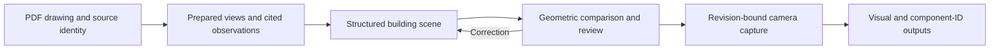

# Blueprint Pilot: engineering notes

Blueprint Pilot connects architectural drawing intake, structured building scenes, geometric review and camera capture. Its three-phase direction is house modeling, house/site/landscape integration, then realistic interior walkthroughs and photorealistic interior visuals. House modeling is working in the Gemini prototype; phase 2 refinement is the current focus. Harufumi Nomura led the design, implementation, debugging and review, with Codex and Gemini coding assistance.

These notes describe mechanisms identified in private implementation files on 15 October 2026. The two prototypes cover different parts of the workflow; the evaluation protocol below is proposed work, not a completed benchmark.

## Architecture

This is a responsibility map across the project. It connects drawing evidence to components, geometry corrections and captured views; it does not imply identical implementations in both prototypes.

**Python prototype:** PDFium intake records source hashes and page inventories. Authoring/model records carry evidence references and component identities. CAD/mesh processing feeds local review and capture. Python handlers and Rust adapters share a project-command contract, while backend checks enforce workflow requirements.

**TypeScript prototype:** PDF.js supports drawing display, Three.js renders structured scenes, and Tauri provides the desktop shell. The model builder selects bundled scenes for recognized sources and has a procedural fallback. Floor-section checks compare scene traces with scene geometry, providing an internal consistency check rather than an independent comparison with the original PDF.

## Design decisions

### Preserve evidence and relationships

Dimensions, interpreted lines and appearance choices have different meanings. The Python authoring path validates source references and rejects unresolved evidence in relevant authoring inputs. Source-precedence logic preserves drawn instances when a supplemental schedule count differs.

Typed components and hosted openings represent relationships explicitly. A room label alone cannot establish enclosure; geometry checks need to inspect wall footprints and object locations. Evidence records add preparation work but make a correction explainable.

### Separate geometry from visibility

An opening can exist in a model and remain hidden from a selected camera. A useful investigation distinguishes source presence, modeled presence, camera visibility and final-image appearance.

Explicit cameras and paired RGB/component-ID outputs support that investigation. These are rendered component identities, not the output of a trained segmentation model; their value still depends on correct geometry and registration.

### Bind review results to revisions

The Python five-view gate checks source/model bindings and relevant artifact hashes. Its measurement code compares cited PDF vector features with visible mesh edges across top/front/rear/left/right views. Missing source features remain pending; a favorable distance alone does not establish completeness.

Revision bindings address a practical failure: geometry changes while an older successful check or capture remains visible. Saved project evidence, review state and bounded worker operations also support recovery during long modeling workflows.

## Existing evaluation mechanisms

- Python source-to-visible-mesh feature measurements, source/model identity checks and explicit pending/conflict states.
- Python paired RGB/component-ID captures, capture contracts and semantic artifact checks.
- TypeScript floor-section coverage/location comparisons and camera/capture checks.

These mechanisms provide places to measure and diagnose behavior. Their existence does not establish complete coverage, passing application acceptance or generalization to unseen plans.

## Proposed architectural benchmark

Use permission-cleared drawings with independently reviewed element annotations, dimensions, cross-view correspondences and ambiguity labels. Split by building/project, keeping revisions and related plans together to prevent leakage. Hold out unseen projects and report known-plan fixtures separately.

| Question | Measurement | Reference |
| --- | --- | --- |
| Are elements complete and correctly typed? | Per-class precision/recall; missing and extra instances. | Independently annotated supported element classes. |
| Is geometry faithful? | Dimension error in declared units, projected feature distance and missing/unsupported coverage. | Registered plan/elevation features and readable dimensions. |
| Are identities consistent across views and revisions? | Correspondence accuracy and identity switches. | Reviewed physical-element IDs and mappings. |
| Are relationships valid? | Opening-host errors, unsupported cuts and enclosure/contact violations. | Domain-reviewed relationship expectations. |
| Does the workflow help complete a task? | Assisted/unassisted completion, correction time, failures and recovery. | Fixed tasks and explicit success criteria. |

Separate learned predictions, manual input, fixture selection and deterministic geometry operations in every result. Detection metrics apply only where a detector is actually used.

Include missing elevations, inconsistent dimensions, rotated sheets, ambiguous symbols, interrupted jobs, stale model/camera bindings and save/reopen. Retain source/build identities, operator interventions, outputs and failure reasons. Report denominators and distributions, with unresolved cases retained.

## Current evidence and next step

The public media includes an application demonstration, historical exterior visualizations, a separate interior walkthrough and four photorealistic interior examples. The walkthrough and interior gallery illustrate the planned phase 3 experience for customer presentations and future listing media; integration into Blueprint Pilot remains planned. These media do not establish source-plan fidelity or parity with the latest builds. Published results do not yet quantify architectural accuracy, inference latency, generalization or downstream automation success. No custom architectural model-training result is presented.

The next useful artifact is a permission-cleared source crop paired with a typed element record, a model projection and an observed discrepancy/correction. An independently reviewed unseen-plan benchmark would then measure fidelity, completeness and correction effort.

Further context:

- [Prototype details](DEVELOPMENT_TRACKS.md): the two implementations and current phase 2 refinement.
- [Project status and media notes](PROJECT_NOTES.md): the three-phase roadmap, walkthrough and interior/exterior examples.
- [Usage notice](../NOTICE.md): public showcase scope and permissions for media and private application materials.
